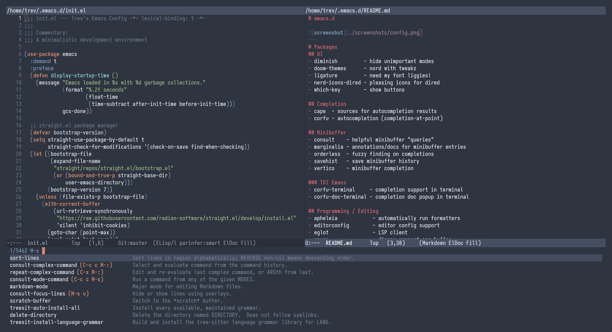

# emacs.d



## Desktop themes

`trev/desktop-theme-selection` resolves and validates
`~/.local/share/trev-themes/active` once per reload; `trev/desktop-theme-load`
then applies that snapshot with Emacs's built-in theme API.
An explicit named-theme action selects `active -> current`, preserving
Niri's saved catalog selection. Umbriel publishes a private generation under
`$XDG_RUNTIME_DIR/trev-themes/noctalia.XXXXXX`, containing only `umbriel.toml`.
The runtime directories and asset must be owned, real and private. Only an
initial deployment without `active` falls back to `current`; an invalid or
dangling active link fails without changing an enabled theme. Home activation
may repair a missing runtime generation after reboot to current.

For an active Noctalia generation, Emacs reads one data-only
`$XDG_CACHE_HOME/noctalia/emacs-palette.json` snapshot (default
`~/.cache/noctalia/emacs-palette.json`). Its exact schema is
`{"mode":"dark"|"light","colors":{...}}`: six six-digit RGB terminal fields
(`background`, `foreground`, `cursor`, `cursor_text_color`,
`selection_background`, `selection_foreground`) plus `color0` through `color15`.
Missing, duplicate, extra or malformed data is rejected before palette/theme
mutation. The cache must be an owned, private regular file, with owned real
parents that are not group/world-writable; existing cache-directory modes are
never changed. Noctalia's guarded `theme-switch` callback writes it even when
Emacs is absent, using a same-directory atomic replacement. The cache and active
link are individually atomic, not a cross-file transaction.

Dark palettes use installed native `modus-vivendi`; light palettes use
`modus-operandi`. Theme-local in-memory overrides map terminal colors to real
UI, syntax, ANSI and semantic roles, including normal/bright intensities and
colored surfaces. For both dark and light Noctalia palettes, the active mode-line
background blends 8% main foreground with 92% editor background; the inactive
background is the editor background. Active text uses the main foreground and
inactive text uses `color8`; selection/completion colors and named themes are
unchanged. The existing common search-color preference is retained;
Iosevka/Noto font preferences and local semantic faces are reapplied. Noctalia
never supplies executable Lisp to Emacs. Keep its independent native Emacs
template/hook disabled. Kitty's native template/hook still owns Kitty separately;
Emacs does not read the live Kitty output.
Emacs only supports the cursor's background color: its text color follows the
underlying text background. The cache's `cursor_text_color` is validated, but
cannot override that native behavior.

All eight named core Modus variants load their installed native themes, ignoring
bundle-local Lisp. Named generated Modus-derived themes retain their catalog
loader. Original per-theme overrides are restored before named selection;
returning to Noctalia reapplies the cached palette. Errors and quits restore
previous overrides, theme definitions/order and appearance, including refreshes
of the same native symbol.

Fresh Emacs processes restore a valid active Noctalia palette with the shell and
Emacs server offline. Cache presence alone does not select Noctalia: after reboot,
activation may repair the missing runtime selection to current. Noctalia
stop/start preserves valid active colors; full-profile Niri startup restores
only its own desktop/wallpaper, not shared application colors.

The after-init initializer starts the independently guarded Emacs server before
loading shared state; a server failure warns but does not prevent initialization.
`C-c T` launches session-aware `theme-switch` asynchronously. The switcher's
reload skips an absent server and uses `emacsclient --alternate-editor=false`,
never a fallback editor. Restart Emacs with this loader before applying the new
cache-based integration. A Nix rebuild does not reload it; never reload the live
init for verification.

Run the isolated theme regressions from this checkout:

```sh
emacs -Q --batch -l lisp/desktop-theme-tests.el -f ert-run-tests-batch-and-exit
```

The harness discovers `modus-themes`, `spacious-padding` and `diff-hl` under
this checkout's `elpa/` (or the invoking Emacs's installed load path); Emacs
provides ERT, use-package, server and diff-mode. Each test runs in a fresh batch
subprocess with disposable HOME, XDG cache/runtime and server directories.
It reads the real Modus `:preface`, `:config` and `:hook` source forms, never the
full init or a live server. Regressions cover dark/light native palette and
semantic colors, subtle-neutral mode-lines, cold-process cache restoration
without a shell/server, unsafe or corrupt state, error/quit rollback,
native/generated source isolation,
faces/fonts, startup ordering/server failures and the asynchronous picker.
Batch face checks do not replace real GUI evidence. Once desktop activation is
separately authorized, restart Emacs with the updated loader, apply Noctalia
dark/light palettes, inspect default/syntax/region/diff colors and unchanged
fonts, then restart Emacs with Noctalia stopped to observe cache restoration.
Explicitly select named native and generated themes and return to Noctalia;
do not expect a session switch alone to reset shared colors.
